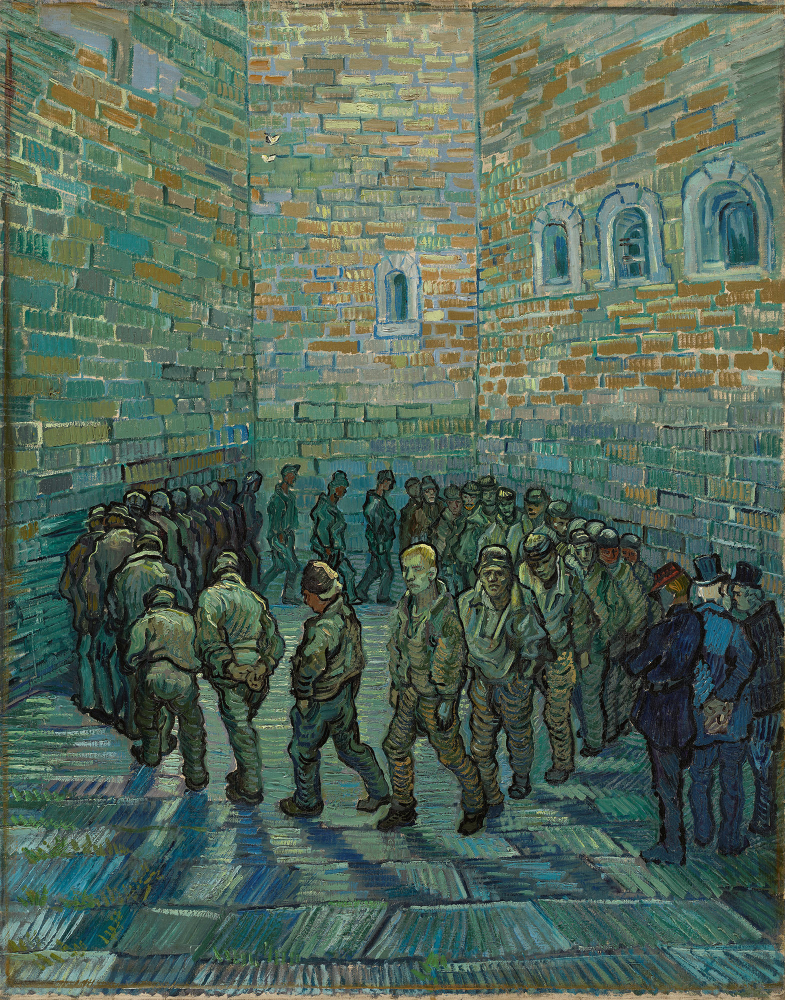

{#fig-pope fig-alt="INSERT ONE!" fig-align="center" width="60%"}

### Introduction

The idea of a hedge fund dates back to 1949 when the American sociologist Alfred Winslow Jones established a small investment partnership that sought to hedge market risk by shorting stocks and using leverage alongside his more traditional long positions. Jones sought "pure alpha" without any exposure to the broader market \[CITATION!\]. By allowing short positions and leverage into his portfolio, Jones expanded the set of possible portfolio returns, and by choosing his leverage and long and short positions carefully, his portfolio reflected his outlook better than any long-only portfolio possibly could. \[INSERT A SENTENCE SUMMARIZING HIS PERFORMANCE.\] Through these means, Jones had reduced the problem of *incompleteness*, which is academic jargon that refers to the problem where not every contingency can be hedged, i.e. not every outlook and forecast can be reflected by a portfolio. Jones discovered that shorting allowed him to hedge the risk that he didn't want to expose himself to, creating a novel payoff structure not available to long-only investors. In more mathematical terms, Jones enlarged the feasible set from which he chose his -- what we might think of as *optimized* -- portfolio. Symbolically (and approximately), he discovered that he could achieve better risk-adjusted returns by not limiting himself to long-only portfolios $\mathcal{A}_{\text{long}}$: $$\begin{aligned}
\mathcal{A}_{\text{long}} := \Big \lbrace w \in \mathbb{R}^M : \sum_{j=1}^M w_j = 1, w_j \geq 0 \Big \rbrace \Longrightarrow \Big \lbrace w \in \mathbb{R}^M : \sum_{j=1}^M w_j = 1 \Big \rbrace =: \mathcal{A}
\end{aligned}$$

As every mathematician knows, expanding the feasible set never hurts and frequently helps.

{#fig-lovers fig-alt="INSERT ONE!" fig-align="center" width="100%"}

### Other

ADD A SENTENCE OR TWO ABOUT HOW CONSTRAINING THE FEASIBLE SET FOR $w$ gives $\mathcal{Q}$ some width, thus expanding $\mathcal{Q}$ into a $K - 1$-dimensional region defined by inequalities. I'll need to talk about $\mathcal{Q}_c$, which is the $w$-constrained version of $\mathcal{Q}$. Should I talk about how $\mathcal{M}_{w^*}$ and $\mathcal{M}_{q^*}$ will be different now?

\[INSERT FIGURE SHOWING SIMPLEX GEOMETRY WHEN THE PORTFOLIO IS CONSTRAINED (or at least consider it)\]

The figure will be the same as above except $\mathcal{Q}$ will be replaced with some $\mathcal{Q}_c$, a $K-1$-dimensional region. I suppose $\mathcal{M}_{w^*}$ and $\mathcal{M}_{q^*}$ will be different now (they'll be regions, no?), so what should I do about them? I suppose I should show $q_c^*$, which is the same idea as $q^*$ except it's for $\mathcal{Q}_c$. I should probably also $q^*$ and how that's farther from $p$ than is $q_c^*$.

{#fig-slave fig-alt="INSERT ONE!" fig-align="center" width="40%"}

{#fig-prisoners fig-alt="INSERT ONE!" fig-align="center" width="65%"}
