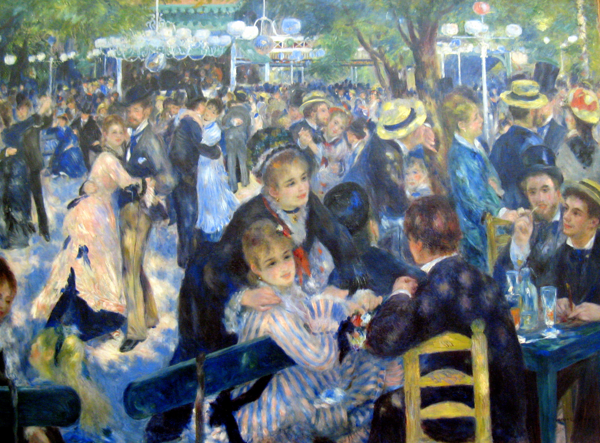
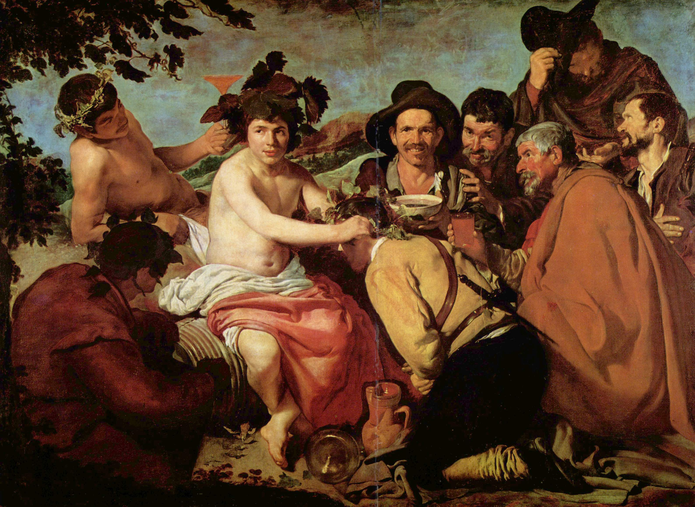
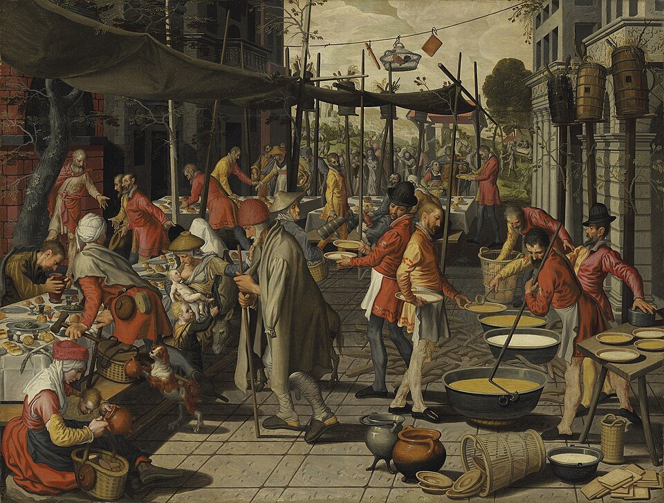
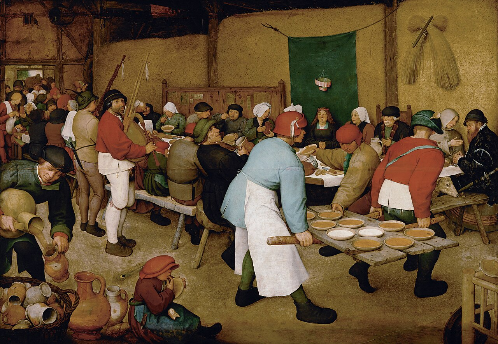

{#fig-bal fig-alt="INSERT ONE!" fig-align="center" width="100%"}

### Introduction

{#fig-borrachos fig-alt="INSERT ONE!" fig-align="center" width="100%"}

### *Adhuc locus est*

Matthew 22: 9-10 (NIV)
"So go to the street corners and invite to the banquet anyone you find.’ 10 So the servants went out into the streets and gathered all the people they could find, the bad as well as the good, and the wedding hall was filled with guests."

Luke 14:21-23 (KJV)
"...Go out quickly into the streets and lanes of the city, and bring in hither the poor, and the maimed, and the halt, and the blind.
22 And the servant said, Lord, it is done as thou hast commanded, and yet there is room.
23 And the lord said unto the servant, Go out into the highways and hedges, and compel them to come in, that my house may be filled."
The famous Latin phrase from this parable is "Adhuc locus est": "there is still room"

{#fig-parable fig-alt="INSERT ONE!" fig-align="center" width="100%"}

### Generalized decomposition formula

If there are $f$ such steps used to construct $\tilde{G}$, then we have a sequence $G_0, G_1, ..., G_f = \tilde{G}$, where $G_0$ is the $K \times 1$ matrix containing only the risk-free asset, i.e. $G_0 = r \mathbb{1}$. We can then define the sequence $\mathcal{Q}_0, \mathcal{Q}_1, ..., \mathcal{Q}_f$, via $\mathcal{Q}_i = \mathcal{Q}(G_i)$, i.e. the set of all risk-neutral probability measures for $G_i$. Note that $\mathcal{Q}_0 = \Delta^{K-1}$ and $\mathcal{Q}_f = \lbrace \tilde{q} \rbrace$ is the set containing the unique risk-neutral probability measure of $\tilde{G}$. Since $G_i$ is a submatrix of $G_{i+1}$ for all $0 \leq i \leq f -1$, $\mathcal{Q}_{i + 1}$ is an affine subspace of $\mathcal{Q}_{i}$. Defining $q_i^* = \arg \min_{q \in \mathcal{Q}_i} D(p || q)$ and $w_i^*$ as the optimal portfolio for $G_i$, we can apply a telescoping argument to the decomposition formula to deduce that

$$
\begin{aligned}
\boxed{\rule[-1ex]{0pt}{4ex} D(p ||\tilde{q}) = \sum_{i=0}^{f-1} D \left(p || m(q_{i+1}^*, w_i^*) \right)}
\end{aligned} \tag{3.5}
$$
where I have used the fact that $q_0^* = p$. Note as well that $m(q, w_0^*) = q$ for any $q$ since the payoff is always equal to $r$ for $G_0$. Importantly, this formula holds regardless of the nature of the sequence $G_0, G_1, ..., G_f$ and regardless of $f$, so long as the sequence is an ordered list of increasing submatrices. Put differently, the total information divergence is perfectly partitioned by any such sequence. I imagine I will have more to say about this formula in the future; for now, I am content ending this section with the following figure, which illustrates this telescoped sum by constructing $\tilde{G}$ one asset at a time.

which we can think of as a conservation law: $$\text{``constant} = \text{edge} + \text{stranded''}$$

Importantly, all of the results in this discussion can be generalized by replacing $\tilde{G} \in \mathbb{R}^{K \times K}$ with $G'$, where $G'$ is any supermatrix of $G$ formed by adding more columns to $G$. In this case, $\tilde{q}$ would be replaced by the minimizer over $\mathcal{Q}(G')$. Suppose, as in the following figure, that we consider all of the possible submatrices $G$ of $\tilde{G}$ that include the risk-free asset. There are $\sum_{k=0}^{K-1} \binom{K-1}{k} = 2^{K-1} - 1$ such proper submatrices, as there are $K-1$ risky assets to choose from and we don't include $\tilde{G}$ itself. We can imagine progressively constructing $\tilde{G}$ in a sequence of steps beginning from the minimial portfolio that holds just the risk-free asset by adding one or more additional assets at each step to form a growing sequence of submatrices of $\tilde{G}$, which terminates with $\tilde{G}$ itself. 

{#fig-peasant fig-alt="INSERT ONE!" fig-align="center" width="100%"}

### Ancillary

1. The classical result re greedy algorithms and submodularity is Nemhauser, Wolsey & Fisher (1978). Submodularity is not a technicality in that theorem — it is the whole engine. Drop it and there is no constant-factor guarantee at all. See also Das & Kempe (2011) who formalised the degradation via a "submodularity ratio."