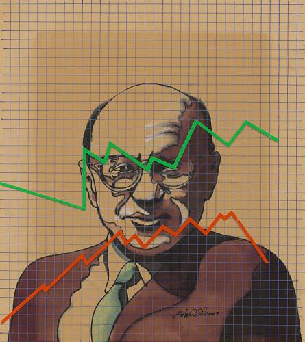

# Introduction

INSERT INTRODUCTION

::: {#fig-thousand-li} 


Wang Ximeng, *A Thousand Li of Rivers and Mountains*, 1113. The Palace Museum, Beijing. [At nearly forty feet long, this priceless work of art is a hand scroll painted on silk using azurite (blue) and malachite (green) that was designed to be unfurled slowly, revealing the vast Chinese landscape and scenes from the daily lives of ordinary people living during the Song Dynasty. Less well known than other major dynasties, such as the Han and Qing Dynasties, the Song Dynasty (960 - 1279) was a period of immense wealth and incredible achievement in culture, science, technology, and administration, which cumulatively mark it as one of the most accomplished empires in human history. [View full resolution&nbsp;↗](<a-thousand-li-of-rivers-and-mountains(complete).jpg>){target="_blank" rel="noopener"}]{.caption-note}
:::


# Life (and death) under Mao
::: {.epigraph}
“There is great chaos under heaven; the situation is excellent.”

— Mao Zedong
:::

There is no doubt that one of the most consequential economic events over the last half century has been the rise of China from a deeply impoverished nation of nearly a billion peasants to an economic juggernaut capable of rivaling the United States. This radical transformation came on the heels of the turbulent and tyranical rule of the communist dictator and former revolutionary Mao Zedong, whose death on September 9, 1976, almost exactly fifty years ago, marked the beginning of a new chapter for China. The degree of destruction and despair wrought by Mao during the twenty seven years beginning with the Communists' victory over the Nationalists on October 1, 1949 and lasting until his death in 1976 is rivalled by very few men in history and is still largely underappreciated in the West.


#### Pre GLF

In the initial years after winning the Chinese Civil War in 1949, Mao ruthlessly consolidated power and began to socialize the war-ravaged Chinese economy, which had been characterized by peasant farming. Millions of landowners were divested of their property, which was forcibly redistributed to peasants, and Mao implemented his vision of violent class struggle across the country. Markets, private property, and urban entrepreneurship were increasingly brought to heel. 

1. CAMPAIGN TO SUPPRESS COUNTERREVOLUTTIONARIES (1950-1952): killing quotas of 1 in 1000; local officials demonstrate their zeal by killing two or three times above the quota;
1. KOREAN WAR (1950-53): 
1. LAND REFORM CAMPAIGN (1950-1953): division into 5 socio-economic bands from landlords to farm laborers; nearly half of China's cultivatable land is forcibly redistributed to peasants; trained operatives called "work teams" sent to rural villages to spark bottom-up unrest and "speak bitterness"; struggle sessions, mob violence, and public execution of landlords
1. 3 ANTI-CAMPAIGN and 5 ANTI-CAMPAIGN (1951-1952): culminated in mass suicide among those who had previously achieved some modicum of success in business, management, or government administration, esp in Shanghai, where there were over 600 confirmed such suicides in just two months
1. MUTUAL AID TEAMS (1951 - 1954) of 3-10 housefolds formed, ownership is still private; this was essentially small-scale pooled labor during peak seasons
1. UNIFIED PURCHASE AND SALE SYSTEM (1953): the government establishes itself as the sole buyer of grain (a monopsony), and farmers were forced to sell grain to the state and below-market prices in order to subsidize cities, and thereby facilitate industrial growth
1. AGRICULTURAL COLLECTIVIZATION (1953-1956): peasants assembled into large cooperatives and peasants stripped of the land that had just received from the land reform
1. LOWER STAGE APC (1953 - 1955): 20-40 households per APC (basically a small village); village land was pooled but farmers still receive private dividend payments, and private plots still allowed;
1. FAMINE (1954 - 1955): due to floods along the Yangzte River and draconian grain procurement programs; the government temporarily backed off from its procurement, but only after hundreds of thousands had died; poor waterworks along the Yangzte and Huwai Rivers created by the CCP struggled to control the flow of water and exacerbated the problem
1. DEEPENING OF COLLECTIVIZATION (1955-56): 
1. FIRST 5-YEAR PLAN (1953-1957): emphasizes industry over agriculture and consumer goods
1. DESTALINIZATION (1956-)
1. 100 FLOWERS BLOOM (1956) + ANTI-RIGHTIST CAMPAIGN (1957)
1. HIGHER STAGE APC (1956 - 1958): 100-300 households (a whole village) collectivized their land and resources; dividends abolished and payment was only for labour performed; this stage marked the complete liquidation of private property in rural areas except for small private plots, cooking wear, etc.; replaced with giant communes 
1. HUKOU SYSTEM (1958): formal implementation of household registration, largely as a reaction of rural-to-urban migration caused by rural economic policies that caused widespread harship as well as food shortages in urban areas, so registration was needed so everyone could be rationed a sufficient amount of food
1. GLF (MAY 1958 - 1962)

- millions of people were killed in the early 1950s during the Campaign to Suppress Counterrevolutionaries and the Land Reform Campaign
- psychological manipulation and coercion began almost from the beginning in 1949
- shortages of food and basic supplies in rural villages occurred years before the start of the GLF.
- civil society stamped out; churches and religious organized suppressed and snuffed out;
- proliferation of re-education and labour camps
- consolidate power, defeat remaining local warlords and opposition from the GMD; dissolution of civil society, institutions and organizations 
- children were not spared from political violence, and children as six were executed
- "carefully cultivated Auschwitz of the mind" (a quote found in Dikotter's book Tragedy of Liberation)
- traditional societal structure, which had evolved over millenia, was systematically gutted; the authority of clans and elders was undermined and replaced by the national governemnt
- fear of "capitalist tendencies" leads to gradual collectivization of land 1953 - May 1958, as peasants have their new land stolen from them


In spite of the chaos, by the early 1950s agricultural and industrial production levels had reached pre-war levels, so in 1953 Mao launched a more ambitious campaign in his first Five Year Plan. He quickly became unsatisfied, however, with the pace of China's transformation towards complete socialization of the Chinese economy, so in 1955 Mao decided to accelerate the collectivization of agriculture and the growth of the state in economic affairs. Emboldened by an ongoing crackdown on "rightists" in 1957 and inspired by a meeting with Nikita Khrushchev later that year, in May of 1958 Mao embarked on what is likely the most disastrous economic experiment in human history: the Great Leap Forward.


#### The Great Leap Forward

The Great Leap Forward was Mao's rapid and brutal campaign to industrialize the Chinese economy by forced nationalization of industry and collectivization of agriculture. It abolished private ownership of farms, livestock, equipment, and any other means of production. Peasants who failed to meet unrealistic quotas for crops were punished. Village social structure and the family unit were systematically dismantled, as peasants were forced into massive communes often numbering 20,000-30,000 people and ate -- when there was food -- in shared cantines. Private kitchen gear and utensils were confiscated and used for scrap metal.  The goal was to free up labour from household chores and to enforce a strict communal ethos on villages, at a time when the vast majority of Chinese were rural villagers. As part of his initiative to produce more steel than the United Kingdom by the early 1970s -- which was encapsulated by the slogan "Surpass Britain and catch up with America!" -- Mao and the Central Committee of the Chinese Communist Party (CCP) set impossible steel quotas so that the excess could be funneled to the cities to industrialize. Peasants were given no option to fail, so out of sheer desperation they began throwing virtually every source of metal, from bolts and nails to door knobs and agricultural equipment, into makeshift, backyard foundries, which were fueled from forests that were stripped down overnight. The result of these efforts? Useless pig iron.

1. May 1958: official launch of the GLF at the 8th Party Congress
1. mid-late summer 1958: establishment of people's communes and mass mobilization; rural workers often directed to work on infrastructure projects rather than farming
1. Summer 1958: production exagerated by local officials and leadership intensifies efforts
1. late summer 1958: further collectivization
1. fall 1958: backyard blast furnaces established to meet unrealistic steel quotas; establishment of cantines
1. late 1958: first signs of extreme economic distress appear in some regions
1. spring 1959: despite widespreads reports of grain shortages, the government continues to procure excessive amounts of grain from villages
1. 2 Jul - 16 Aug 1959: Lushan conference; Peng purged for criticisms
1. 1960: peak famine, millions die in an utter calamity
1. spring-summer 1960: anti-sparrow campaign is curtailed and other minor adjustments are enacted
1. Jan 1961: Ninth Plenum; leadership agrees to prioritize economic recovery over ambitious production targets; pragmatism increasingly emphasized over ideology
1. late 1961: famine begins to ease
1. 1958-1962: 15-45 millions people die of starvation

- what: Mao's disastrous economic policy that led to the starvation of tens of millions of people in which Mao discarded the comparatively slow approach to economic development characterized by Soviet-style 5-year plans and sought far more rapid industrialization; backyard steel production; basic welfare of peasants was subordinated to unrealistic production goals and communist ideology
- who: Mao primarily
- why: Mao wanted to accelerate the reforms enacted since 1949; wanted to catch up to the UK in steel production in just 15 years; wanted to rapidly industrialize to transition from socialism to communism; Mao believed rapid industrialization was largely a matter of will and ideological zeal rather than careful bureaucratic management and technocratic expertise; Mao had also grown distrustful of the Soviets, whom he believed had been taken over by bourgeois forces -- China could follow its own path;
- causes of mass starvation: significantly reduced output due to labour diversion and collectivization (e.g. weakened incentives, no price mechanism, etc), diversion of resources of countryside to cities, coercion of villagers, abolition of all private property, melting of agricultural tools for scrap metal, destruction of sparrow population, top-down control of the economy, unrealistic quotas, suppression of criticism, feedback, and information, 
- communes: massive expansion of advanced APCs, not only incorporated agriculture but also industry, government, and education with massive mess halls/cantines; communes ended the idea of a township, and the commune became the government in a certain sense; people were grouped according to military organization, e.g. regiments, i.e. militarization of society; home cooking was banned; backyard blast furnaces were created; communes implemented Marx's "from each...to each..." whereby payment for labour was largely replaced by a system of payment for "need" in the form of rations regardless of work performed; a commune was society, economy, and government wrapped up into one amorphous entity
- the Anti-Rightist Deviation campaign of 1957 had taught people not to question Mao's directives


::: {#fig-glf-propaganda layout-ncol=2}

![Wu Shaoyun, Zhang Yuqing, and Lu Zezhi, [公社如巨龙，]{.nowrap}[生产显威风]{.nowrap} \[The commune is like a giant dragon; production shows its might\], 1959. IISH, BG E13/593.](commune.jpg){#fig-commune fig-alt="..."}

![Zhang Ruji, Wang Shuhui, and Shao Guohuan, [鼓足干劲争上游，]{.nowrap}[东方跃进西方忧]{.nowrap} \[Go all out and aim high; the East leaps forward, the West is worried\], 1958. IISH, BG E16/33.](greater_faster_better_cheaper.jpg){#fig-dragon-boat fig-alt="..."}

REWRITE THIS: Two Great Leap Forward posters. (a) Commune members ride a dragon through clouds, hoisting a basket of the harvest, with smokestacks and a "Leap Forward Gate" (跃进门) behind them. It was published in September 1959, as the famine was beginning. (b) A dragon boat sails past Western figures shipwrecked on rocks labelled "economic crisis" (经济危机). The sails read 多快好省, "more, faster, better, cheaper," Daft Punk's *Harder, Better, Faster, Stronger* forty-three years early. Images courtesy of chineseposters.net; (a) translation adapted.  
:::  


 so     that led to what is likely the greatest famine in history: it is thought that by the time it ended in 1962, over 15 million people had died, likely far more [CITATION]. The sheer scale of the devastation, which was perhaps even more severe than that suffered by the Soviet Union during World War II, led Mao to step back from economic governance of the country in 1962, allowing the relative pragmatists Liu Shaoqi and Deng Xiaoping to take over. 

#### Recovery

1. mid summer 1959: Lushan conference, in which Peng Dehuai criticizes the GLF and is purged
1. late summer 1959: backlash against critics in "Anti-Right Deviation" campaign
1. 1960: walk back campaign to destroy sparrow population
1. 1961: further reforms led by Liu and Deng stem some of the destruction caused by Mao's policies
1. 3 Freedoms and 1 Guarantee: private plots, free markets, and self-responsibility + household quotas. Led by Liu and Deng. 3/1 was successful in stabilizing the economy. Famine subsides; 3/1 formed the basis for the Household Responsibility System, which emerged in the late 1970s; in both cases, people do not own land but instead are allocated land that they are responsible for
1. Mao viewed 3/1 with deep suspicion, believing it to be a revisionist course along the "capitalist road"
1. 11 Jan 1962: 7000 Cadres Conference, Mao's self criticism, Liu's 30/70 speech
1. end of 1962: the worst of the GLF policies and consequences of those policies are now a thing of the past


#### The Cultural Revolution

1. 1966: 3/1 is branded as "revisionist" by Mao
1. 1967: Liu and Deng arrested
1. 1969: Liu dies in prison

Only four years later, in 1966 Mao launched his Cultural Revolution to rid Chinese civilization of "bourgeois elements", which lasted until his death. Fueled by communist ideology, this campaign led to the deaths of up to two million more people, as son turned on father and husband on wife. Perhaps most disturbingly, from 1967-1968 divisions between provincial communist leadership and more zealous elements culminated in the Guangzhi Massacre, in which over 100,000 people were lynched and murdered, and, at least in Wuxuan County, *eaten*, in what is the most famous example of ideology-driven cannibalism in modern history [CITATION]. JORDAN, EMPHASIZE THAT THE CULTURAL REVOLUTION NOT ONLY INSTILLED FEAR BUT STIFLED CREATIVITY, INDUSTRY, ETC


#### Whatever You Say, Man

It was not immediately clear when Mao died in September 1976 that there would be any meaningful change of policy, nor was it initially clear where ultimate power lay. Hua Duofang, a strong supporter of Mao, was Mao's chosen successor, but he lacked the broad political support from the upper echelons of the Chinese state that he needed to truly secure his position as Paramount Leader. Opposed to Hua was the Gang of Four, which was led by Mao's widow who wished to consolidate power for herself, and three very powerful hardline CCP officials. After they declared their opposition to Hua's authority and anyone who might wish to depart from Mao's vision for China, Hua had them arrested on October 6 and had himself declared as Chairman of the Chinese Communist Party the very next day. 

Though a firm supporter of Mao and Maoism, Hua recognized the excesses of some of Mao's policies, especially the Cultural Revolution, and the need for China to nurse its wounds and rebuild. He rehabilitated thousands of politically persecuted intellectuals and professionals, restored the national university entrance exam (which rewarded merit rather than ideological purity), reappraised scientists as vital to China's future rather than enemies of class struggle, and embarked on a mission to implement the Four Modernizations, which consisted of agriculture, industry, defense, and science and technology. Though Hua had solved the problem of the Gang of Four, he understood that he lacked complete legitimacy in the eyes of some of the less ideological elements of the CCP, especially the military, who had urged Hua to reverse Mao's purge of Deng, as they believed Deng's pragmatic leadership was vital to China's recovery from the Cultural Revolution. In what was arguably Hua's most consequential decision, in mid 1977 he relented, contravening Mao's purge of Deng and restoring Deng to his prior political positions. 

Even if he was less zealous than Mao, Hua was still a firm communist who believed in a command economy. He supported collectivization, state-run industry, bans on private property, and state-directed economic priorities. In this vein, in February 1977 Hua publicly vowed to uphold whatever policies Mao had instituted and carry through whatever instructions Mao had ordered, in what came to be termed the "two whatevers". This helped to legitimize him as a natural successor to Mao, but it was also contradicted by his reforms, especially the restoration of Deng later several months later, as Deng had been stripped of his authority by Mao. It also worried less zealous officials within the party and military who cared less about ideological purity and more about competent administration.

By the end of 1978, however, after less than two years of careful and strategic political maneuvering, the rehabilitated Deng managed to wrest ultimate control of the Chinese state from Hua and become China's Paramount Leader, and unlike Hua, Deng was a pragmatist who favored practical solutions over ideological purity, as the epigraph above attests. This pragmatic outlook had led to his prior expulsion from the Chinese Communist Party at the outset of the Cultural Revolution, as his advocacy for practical solutions to China's extreme poverty, which included a small degree of privatization of agricultural land, were seen as an attack on Mao's communist ideology. Deng was then stripped of all of his authority within the Party and was bannished to Jiangxi province to do manual labour in a tractor factory. Nonetheless, by the end of 1978, this "number two capitalist roader" (an epithet used to describe Deng as the second most egregious proponent of capitalism) had definitively, though gradually and peacefully, displaced Hua as the most powerful man in China.


# Reform and Opening Up
::: {.epigraph}
"It doesn't matter if a cat is black or white, so long as it catches mice."

— Deng Xiaoping
:::


When Deng came to power, people were cautiously optimistic, e.g. Friedman and Lee Kuan Yew. Everyone was familiar with the Asian Tigers by that point.


In contrast to Hua's "two whatevers", Deng and his allies championed a new epistemology, summarized by his 1978 essay entitled "Practice is the Sole Criterion of Truth". 

STATISTICS ABOUT CHINA'S POVERTY IN, SAY IN 1978 OR 1980. 

In 1978, the year Deng Xiaoping became paramount leader, China's life expectancy at birth was 63 years (WB_WDI_SP_DYN_LE00_IN), \[INSERT 2-3 SENTENCES ABOUT THIS PROFOUND CHANGE, e.g. GDP changes or other measures or economic growth\].

Although many people doubted that a nation deeply committed to Marxism-Leninism-Maoism could reinvent itself into a thriving market economy, as early as 1980 some astute observers noticed the sincerity of the commitments Chinese leadership had made to economic liberalization beginning in the late 1970s. One such observer was Milton Friedman. Quoting a report he wrote in 1980 on Deng Xiaoping's efforts to unshackle the Chinese economy from paralyzing top-down control, Friedman remarked years later that he had viewed Chinese economic liberalization as "one of the great economic experiments of our time". In that same report, he elaborated further: "The reforms – the attempt to introduce market elements, the opening up of contacts with the West, the encouragement of foreign investment, and so on – are in a desirable direction....The potential is enormous. The present level is extremely low....My own conjecture is that there will be considerable progress in the next few years as some of the newly announced policies work themselves through the system."[^2] The Singaporean leader Lee Kuan Yew was even more optimistic, saying in 1980 "\[INSERT LEE KUAN YEW'S OBSERVATIONS\]"\[\^3\]

MENTION THAT THE ECONOMY SOFTENED 1989-1991 as Deng ceded power to more hardline communists, Tiananmen Sq. Massacre, etc. (cite, eg, % GDP growth figures from WB WDI)


[^2]: Friedman, Milton. “Impressions of China and Hong Kong on a Recent Visit” (speech, April 29, 1994), Hoover Institution, Collected Works of Milton Friedman.

\[\^3\] INSERT CITATION FOR LEE KUAN YEW    

{#fig-friedman width="60%" fig-align="center" fig-alt="INSERT ONE!"}

2-3 PARAGRAPHS ABOUT CHINA'S ECONOMIC EXPLOSION 


1. Dec 1978: Third Plenum of the 11th, and Deng emerges on top
1. 1980: establishment of 4 SEZs, allowing not only a dedicated place with greater adherence to free-market principles but also allowed for foreign joint ventures
1. 1978 - 1983: pilot phase for urban economic reform in which some free market principles were gradually phased in for SOEs for certain regions of the country
1. 1983 - 1985: before 100% of profit had to be remitted to the state; however, this was gradually phased out in favor of a tax
1. Oct 1984: 3rd plenary of the 12th Central Committee and the Decision on Reform of the Economic Structure
1. 1987: the HRS was mirrored in urban areas for industry under the Contract Responsibility System (CRS); far more complex than the HRS; any excess revenue earned and/or product produced above state-mandated quotas could be used for private uses, e.g. investment or pay rises; dual-track pricing
1. mid 1988: Deng attemps immediate price reform, causing a run on banks; inflation spikes
1. late 1988: fearing inflation and civil unrest, conservatives roll back Deng's reforms
1. 1989: Tiananmen Square
1. 
1. 1990s: phase II of privitization in which Zhu Rongji oversaw the privitization of small and medium size SOEs, leading to millions of layoffs but which laid the foundations for a renewed economic boom under Jiang.

- private sector competition against SOEs permitted in the form of TVEs (Town Village Enterprises)
- abolition of the "Iron Rice Bowl"
- Household Responsibility System formally introduced in late 1970s
- Deng's approach was one of pragmatic experimentation. Experiments that were deemed successful were expanded. The command economy was not abolished overnight; Deng's approach and that of his successors was that of gradual reform.
- dual-track pricing eventually led to arbitrage, corruption, and inflation; together with dissatisfaction over a continued lack of political rights, this culminated in the Tiananmen Square protests in 1989
- 199


# You Can't Bet on China

OLD: "Instead, practitioners are left trying to cobble together portfolios that very imperfectly express their views. A portfolio manager who is sanguine about China's future, for example, might be bullish on Chinese companies, believing they will benefit from a thriving economy, but this requires the stock market to be a robust proxy for economic growth. In other words, no amount of shorting or leverage can construct a payoff structure in which the portfolio generates a handsome return if and only if the thesis turns out to be true. There is, therefore, no clean way to bet on this thesis. (In more precise language, there is no combination of tradable assets and portfolio vector whose payoff would be an Arrow Debreu security for this event.) The problem is with the menu of tradable securities: there simply is no security that pays if and only if the event (long-run economic growth) comes to fruition. Such market incompleteness leads to lower profits.""


Those who had successfully predicted the meteoric rise of the Chinese economy were unable to profit from their clairvoyance, as there was -- and is \[CHECK THIS -- YOU MIGHT BE WRONG!\] -- no asset whose value tracks the Chinese economy. Instead, bullish prognosticators have often relied on investments in the Chinese stock market. Unfortunately, as the last several decades have shown, the Chinese stock market has been a very poor proxy for Chinese economic growth.

\[INSERT FIGURE FOR CHINESE ECONOMIC INDICATORS VS ITS STOCK MARKET VS USA'S STOCK MARKET VS WORLD STOCK MARKET\]

```{python}
#| label: fig-china-vs-us
#| fig-cap: "China's economy and China's stocks, each measured against America's. Every quantity is China's divided by America's, so the United States is the numéraire, and every change is in bits. 1 bit = ln 2 ≈ 0.693 nats: one doubling. Top: real GDP per capita, up 4.02 bits (×16) since 1978. That is the change, not the level: in 2025 China's GDP per capita was still ×0.20 of America's, 2.30 bits (about 2.3 doublings) short, in constant 2015 US\\$ at market exchange rates; purchasing-power parity would show a smaller gap. Bottom: MSCI China ÷ MSCI USA (periwinkle) against the same economy line re-based to December 1998 (lime), shaded periwinkle where the stocks outpace the economy and grey where they lag it. The stock ratio fell to −0.78 bits (×0.58) in January 2002, peaked at +1.66 bits (×3.2) in October 2007, and touched its low of −0.84 bits (×0.56) in August 2024; by June 2025, the last month both datasets cover, the economy ratio was up 2.23 bits (×4.7) and the stock ratio down 0.57 bits (×0.67). Later stock data are not shown. Sources: World Bank, World Development Indicators (CC BY 4.0), GDP per capita in constant 2015 US\\$; MSCI, MSCI China and MSCI USA net total return indexes in US dollars."
from china_figure import build_china_figure, china_figure_html
from IPython.display import HTML

HTML(china_figure_html(build_china_figure()))
```

\[INSERT A PARAGRAPH EXPLAINING WHY ITS STOCK MARKET HAS BEEN A POOR PROXY FOR ECONOMIC GROWTH\]

- According to Ben Felix in "Why Economic Growth Doesn't Always Mean Higher Returns", the term "emerging markets" was coined in 1981 to encourage people to invest in foreign markets.
- Jay Ritter's papers:
  - 2005: "Economic Growth and Equity Returns"
  - 2012: "Is Economic Growth Good for Investors"
  - 2022: "What Matters More for Emerging Markets Investors: Economic Growth or EPS Growth?"

Data for US and Chinese economic growth: https://data.worldbank.org/indicator/NY.GDP.MKTP.KD?locations=CN-US

Data for US and Chinese market capitalization from the World Bank: https://data.worldbank.org/indicator/CM.MKT.LCAP.CD?locations=CN-US

Data for US and Chinese stock market performance from MSCI: https://www.msci.com/indexes/index/302400/msci-china-index

Claude wants you to mention that an inability to bet on China was made worse by the fact that foreign investors couldn't buy mainland Chinese A-shares until recently: "The first is the **access point**. Foreign investors could not buy mainland A-shares at all until the QFII programme opened in 2002; access broadened with Stock Connect in 2014; MSCI only began including A-shares in 2018. This is incompleteness in the most literal possible form. The security existed and was not a column of your G. A Western investor in 1985 who was exactly right about China could not act on it even through the imperfect proxy, because the proxy was legally out of reach. This is a sharper illustration than "the proxy was noisy.""\